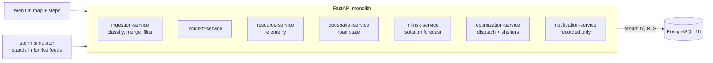

# AI Disaster Response Coordination System

A command platform for a hurricane: it forecasts which neighbourhoods will be cut off from a hospital, decides who goes to which
shelter, turns a stream of citizen reports into incidents, and assigns every response unit at once over whatever roads are still open.

Built from blueprint 1 of "Advanced Project Blueprints, Volume II" as a **vertical slice**: the demo scenario end to end, with the
platform parts real and the rest listed under [Not built](#not-built-and-why).

**The county, the storm and every report are simulated. Nothing here is real, no alert is sent, and every output is decision support for a person.**

## Run it

```bash
docker compose up --build        # migrates, trains the report classifier, serves http://localhost:8201/ui/
docker compose run --rm test     # 87 tests against a throwaway database
```

Open http://localhost:8201/ui/ and press **Run all steps**, or `make bootstrap demo`. API docs at `/docs`.
Demo tokens (local only): `gulf-commander-demo`, `gulf-dispatcher-demo`, `gulf-viewer-demo`.
To run the demo a second time, `make reset` first (its idempotency keys are fixed, so a re-run replays the first answers).

## The demo, step by step

1. Six hours before peak surge: a 14 x 10 km county of 241,481 people, split by a river with four bridges; 8 shelters (4,300 places), 3 hospitals, 24 units. Forecast surge 4.5 m, give or take 0.7 m.
2. The risk model replays the storm 300 times: 29 neighbourhoods (53,464 people) have at least an even chance of having no open road to a working hospital. Two of them stay dry and are simply surrounded. A flood-line rule flags 27.
3. Those 29 are alerted. About 6,415 people are assumed to need a public shelter; the allocation places 4,300 with the least total driving and reports 2,115 with no place.
4. Landfall. Two bridges close. 46 citizen reports become 20 incidents (17 were second reports of the same emergency, 9 were noise). 15 confirmed incidents get a unit; the severity-weighted wait is 22% lower than sending the nearest unit in report order.
5. Peak surge. A third bridge closes, 76 road segments are under water, shelters are full, West General is diverting. 51 confirmed incidents, 24 units: 18 of the 35 severe ones are reached, against 14 in report order.
6. The ambulance on the most severe call drops out. Its incident returns to the queue and the plan is solved again: 4 units redirected, 18 keep their call.
7. The hour-0 forecast is scored against what happened: 36 neighbourhoods actually cut off (the real surge was 4.9 m), 29 caught, 7 missed, no false alarms. The flood-line rule caught 27.

## Architecture



| Piece | How it works |
|---|---|
| Report intake | Character n-gram TF-IDF + logistic regression sorts each report into water rescue, medical, fire, utility or noise. Credibility = model confidence x a weight for the source (911, app, social). A second report of the same type in the same block joins the open incident and raises its confidence; an incident under 0.5 is held for a person. |
| Isolation forecast | Monte Carlo: 300 storms with the surge peak drawn from the forecast and the elevation survey perturbed by its known error. In each, flooded segments and bridges are removed from the road graph and connected components decide who can still reach a working hospital. |
| Dispatch | Exact assignment (`scipy.optimize.linear_sum_assignment`) minimising severity² x travel time over every open incident and every unit at once. Boats cross flooded segments slowly; ambulances and engines cannot. Each incident has a private "nobody comes" option costed at two hours, so with too few units the least severe wait. |
| Shelters | A transportation LP (HiGHS): people from each at-risk neighbourhood to shelters with free places, minimising person-minutes; unreachable shelters excluded; anyone who fits nowhere is reported, not hidden. |
| Platform | Row-level security per tenant, Idempotency-Key replay on every write, hash-chained audit log, role permissions, `/metrics`. |

## Data model

`migrations/002_response.sql` follows the blueprint (incidents, resources, shelters, road_events, dispatches); additions are marked `(+)`:
reports, hospitals, alerts, the scenario clock. Latitude and longitude are plain columns, not PostGIS geography (see Not built).

## API

| Method | Endpoint | Purpose |
|---|---|---|
| POST | `/v1/incidents` | A citizen report: opens an incident, corroborates one, or is filed as noise |
| GET | `/v1/incidents?bbox=&severity=` | Incidents in a bounding box, cursor-paginated |
| POST | `/v1/resources/{id}/telemetry` | Unit position and status; out of service releases its incident |
| POST | `/v1/optimize/dispatch` | Solve the assignment and replace the live plan |
| GET | `/v1/evacuation/routes` | Shelter allocation and the road path for each movement |
| POST | `/v1/alerts/broadcast` | Record an alert and reserve shelter places (nothing is transmitted) |
| GET | `/v1/risk/isolation` · `/v1/risk/isolation/verification` | (+) The forecast, and its score against what happened |
| POST | `/v1/scenarios/hurricane` · `:advance` | (+) Load the simulated county; move its clock forward |
| GET | `/v1/map` · `/v1/resources` | (+) What the map draws |

Contract: [`docs/openapi.json`](docs/openapi.json).

## Measured

[`docs/evaluation.md`](docs/evaluation.md) (`python -m drc.evaluate`, 40 counties the demo never uses) and [`docs/performance.md`](docs/performance.md).

| Component | Result | Baseline |
|---|---|---|
| Isolation forecast, 200 storms (Brier, lower is better) | 0.0265 | flood-line rule 0.0374; base rate 0.1555 |
| Dispatch at peak surge, severity-weighted wait | 19.5% lower on average (8.7% to 40.2%) | report order, nearest suitable unit |
| Severe incidents left without a unit, 40 counties | 416 | 558 |
| Report classifier, 5 classes | 100.0% | keyword rules 92.6% |

The classifier is perfect because the reports come from a small phrase bank; real reports would not be. The forecast is well
calibrated because the simulated storms are drawn from the same distribution it assumes, except for debris closures it does not model.

## The hardest tradeoff

Merging reports. Several people report the same emergency and a fifth of the reports are pinned one block off, so some rule has to
decide whether a new report is a new incident. Merging within one block makes a tidy list (38 duplicate incidents across 40 counties)
but swallowed 1,016 of 3,183 real incidents into a neighbour's: people who called and got no incident of their own. Merging only
within the same block loses 266 and creates 683 duplicates, each of which may draw a unit that was not needed. This build uses the
same-block rule: a wasted boat trip is recoverable and a missed household is not. The cost shows up as scarcer units at peak. A
better answer needs information this build does not have (caller identity, address-level location).

## Threat model (summary)

| Threat | Mitigation here | Gap |
|---|---|---|
| One agency seeing or changing another's incidents | Row-level security on every operational table; tested by loading a second tenant, whose "delete everything" reset touches only its own rows | |
| False or malicious reports drawing units away | Source-weighted credibility; a single weak report is held for verification; noise filtered and kept | No rate limit per caller, no caller identity |
| A retried request dispatching twice | Idempotency-Key replay; a database constraint allows one live dispatch per unit | |
| Disputed decisions after the event | Alerts, plans, status changes and clock moves in a hash-chained audit log | No external anchor |
| Over-trusting the model | Forecast scored against outcome in the product; plans compared with a simple baseline every time; alerts are recorded, not sent | No approval step before a plan goes live |

## Not built, and why

- **Real feeds** (NOAA/NWS, FEMA, OpenStreetMap, GTFS, responder GPS): a deterministic simulator stands in.
- **Computer vision** on satellite or drone imagery: not started. Flood extent comes from the simulator.
- **PostGIS**: the county is a grid, and every spatial question here is a road-network question answered in Python.
- **Sending alerts**: no SMS, cell-broadcast or siren integration; alerts are stored and audited only.
- **Real hydrology**: the surge is a formula (peak x time curve x distance from the coast), not a storm-surge model.
- **Hospital routing** is greedy (nearest reachable hospital with a free bed, most severe first), not part of the optimisation.
- **Kafka, Redis, OpenTelemetry, Grafana, MLflow, Terraform, CI, SSO, a Next.js front end**: not needed to prove the slice; no cloud account used.

## Commercial sketch

Buyer: county and state emergency operations centres, utilities, large NGOs. Pricing shape from the blueprint: annual subscription by
population served, burst pricing during declared events, integration fees, a longer-retention tier.

## Layout

```
core/        platform kit: db + RLS, audit chain, HTTP, scenario runner, load test
drc/         world (county + storm), engine (classifier, forecast, assignment, allocation), api, seed, evaluate
migrations/  forward-only SQL          web/   UI, scenario.json, demo.json (recorded run)
tests/       87 tests                  docs/  evaluation.md, performance.md, openapi.json
```
